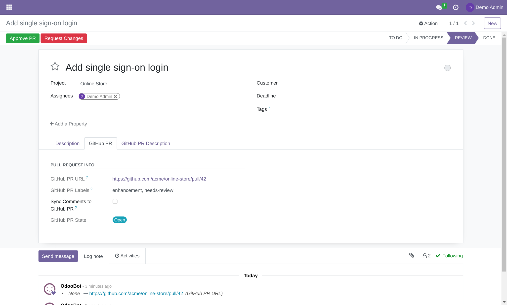
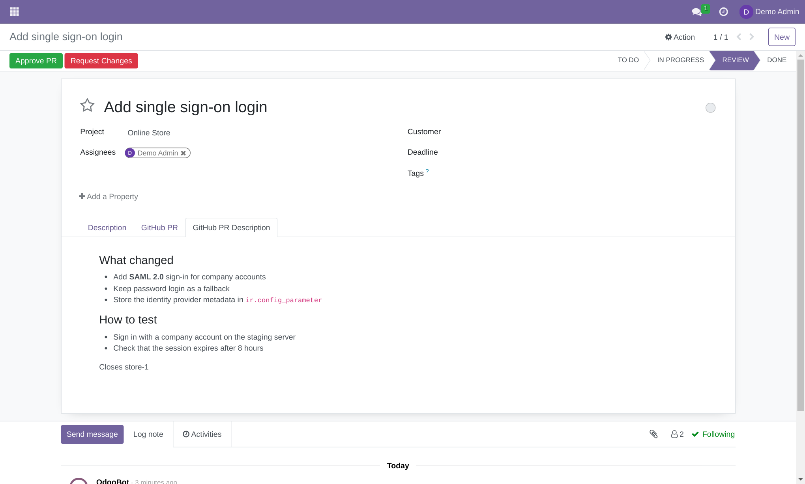
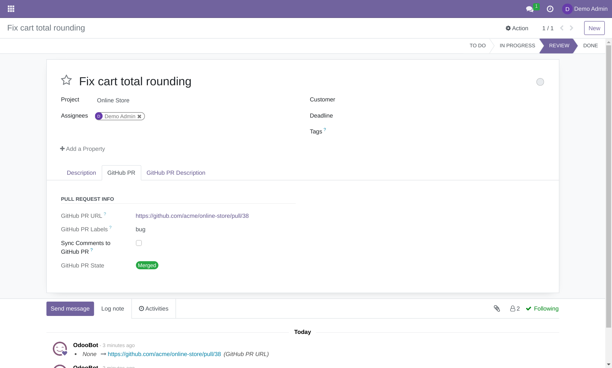
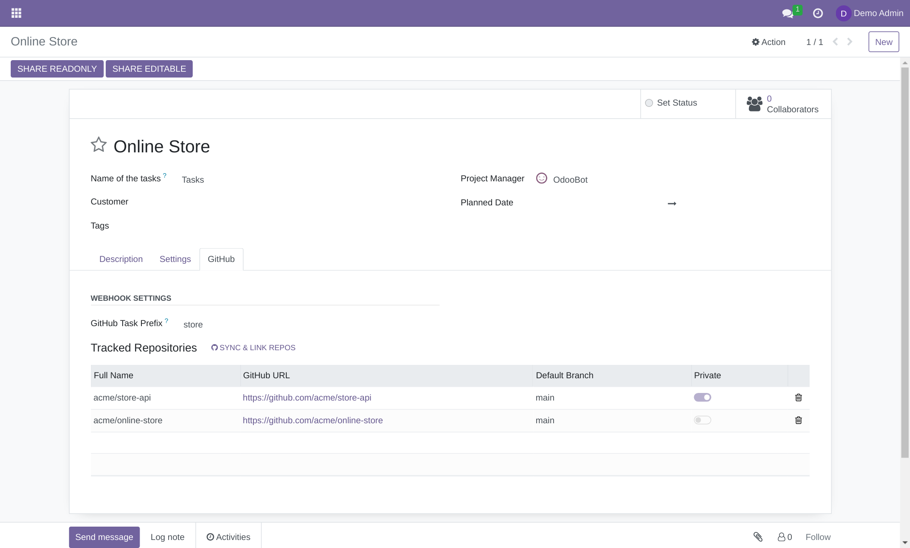
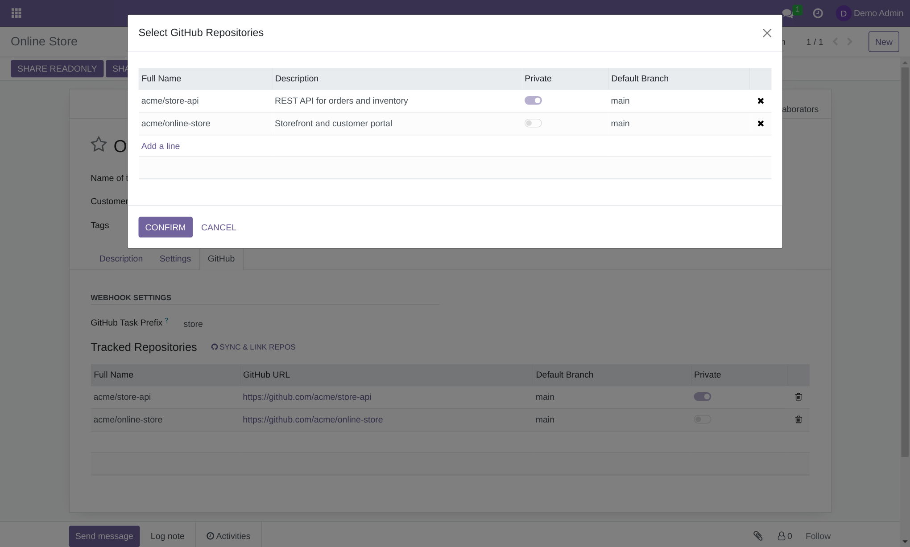
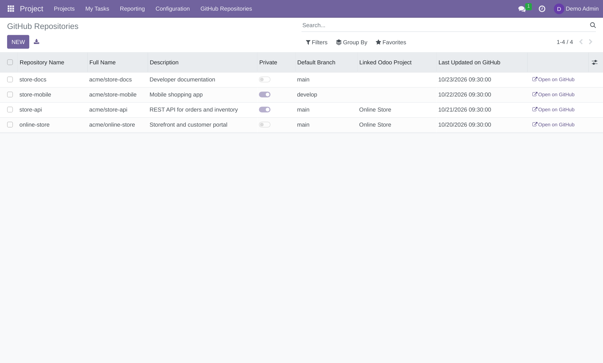
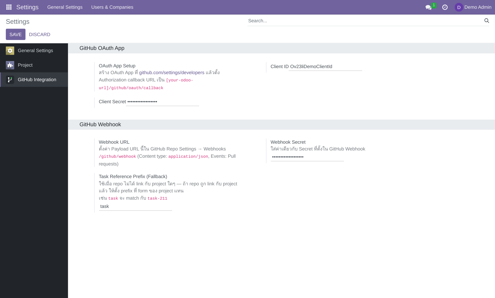
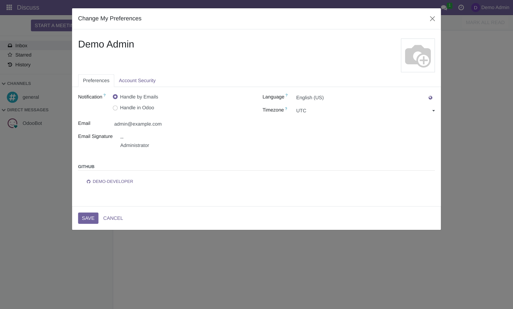
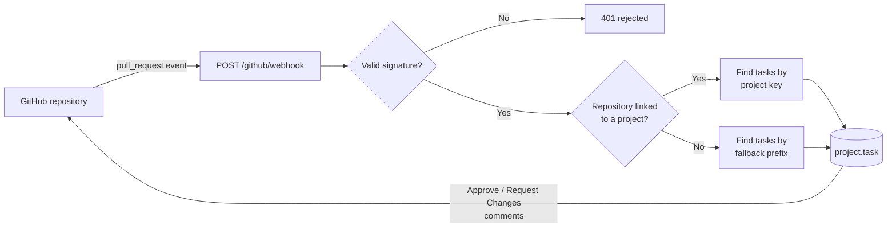

<p align="center">
  
</p>

<p align="center">
  <b>English</b> · <a href="README.th.md">ภาษาไทย</a>
</p>

<p align="center">
  
  
  
  
</p>

<p align="center">
  Link GitHub Pull Requests to Odoo Project tasks automatically.<br>
  See PR status in the task, approve from Odoo, and keep the conversation in sync.
</p>

<p align="center">
  
</p>

## Contents

- [Features](#features)
- [Screenshots](#screenshots)
- [Requirements](#requirements)
- [Installation](#installation)
- [Configuration](#configuration)
- [Usage](#usage)
- [How it works](#how-it-works)
- [Security](#security)
- [Project structure](#project-structure)
- [Running the tests](#running-the-tests)
- [Troubleshooting](#troubleshooting)

## Features

| | Feature | Details |
|---|---------|---------|
| 🔗 | **Automatic linking** | Mention a task in a PR description and the webhook links it. One PR can update many tasks. |
| 🚦 | **Live PR status** | `Open`, `Merged` and `Closed` badges, plus PR labels, stay up to date on the task. |
| 📝 | **Rendered descriptions** | PR descriptions are shown as sanitized Markdown, including code blocks and tables. |
| ✅ | **Review from Odoo** | **Approve PR** and **Request Changes** set the `ok-to-merge` and `fix` labels on GitHub. |
| 💬 | **Comment sync** | Optionally mirror chatter comments to the PR. |
| 🔐 | **GitHub login** | Each user connects their own account with OAuth. |
| 📁 | **Repository management** | Sync your repositories, link them to projects, and edit their descriptions. |
| 🛡️ | **Signed webhooks** | Every delivery is verified with HMAC-SHA256. |

### Video tutorial

[▶️ Watch on YouTube](https://youtu.be/Zz5PNZbrCLQ)

## Screenshots

> Taken from a demo database with sample data.

<table>
  <tr>
    <td width="50%"></td>
    <td width="50%"></td>
  </tr>
  <tr>
    <td align="center"><b>Rendered PR description</b></td>
    <td align="center"><b>Merged PR: review buttons are hidden</b></td>
  </tr>
  <tr>
    <td></td>
    <td></td>
  </tr>
  <tr>
    <td align="center"><b>Project: prefix and tracked repositories</b></td>
    <td align="center"><b>Choose repositories to link</b></td>
  </tr>
  <tr>
    <td></td>
    <td></td>
  </tr>
  <tr>
    <td align="center"><b>Project → GitHub Repositories</b></td>
    <td align="center"><b>Settings → GitHub Integration</b></td>
  </tr>
</table>

## Requirements

| Item | Version / notes |
|------|-----------------|
| Odoo | 16.0 |
| Python | 3.8+ |
| Odoo modules | `project`, and [`project_key`](https://github.com/OCA/project/tree/16.0/project_key) from OCA |
| Python library | `markdown` (optional; without it, descriptions are shown as plain text) |

```bash
pip install markdown
```

## Installation

**1. Get the code**

```bash
git clone https://github.com/madara1150/project_link_github.git /opt/odoo/custom-addons/project_link_github
```

**2. Add the repository folder to `addons_path`.** It is the folder that contains `project_github/`.

```ini
[options]
addons_path = /opt/odoo/addons,/opt/odoo/custom-addons/project_link_github
```

**3. Restart Odoo, then install.** Go to **Apps → Update Apps List**, search for `Project GitHub Integration`, and click **Install**.

**Upgrading from an earlier version?** Update the module and set a webhook secret (see the [security note](#security)):

```bash
odoo-bin -d <database> -u project_github --stop-after-init
```

## Configuration

### 1. Create a GitHub OAuth App

Needed for GitHub login, repository sync, review buttons and comment sync.

1. Open [github.com/settings/developers](https://github.com/settings/developers) and click **New OAuth App**.
2. Set **Authorization callback URL** to `https://<your-odoo-domain>/github/oauth/callback`.
3. Copy the **Client ID** and generate a **Client Secret**.

### 2. Configure Odoo

Go to **Settings → GitHub Integration**:

| Field | Description | Example |
|-------|-------------|---------|
| **Client ID** / **Client Secret** | From the OAuth App | |
| **Webhook Secret** | Required. Must match the secret on GitHub | a long random string |
| **Task Reference Prefix (Fallback)** | Used for repositories not linked to a project | `task` |

### 3. Add the webhook on GitHub

In the repository, open **Settings → Webhooks → Add webhook**:

| Field | Value |
|-------|-------|
| **Payload URL** | `https://<your-odoo-domain>/github/webhook` |
| **Content type** | `application/json` |
| **Secret** | The same value as in Odoo |
| **Events** | **Let me select individual events** → **Pull requests** |

### 4. Connect your account

Open your user menu → **Preferences** and click **Connect with GitHub**. Once connected, the **GitHub** section shows your username; click it to disconnect.

<p align="center">
  
</p>

### 5. Link repositories to a project

On a project, open the **GitHub** tab, set **GitHub Task Prefix** (for example `store`), and click **Sync & Link Repos**.

## Usage

### Link a PR to a task

Mention the task in the **PR description**. Matching is case-insensitive.

```markdown
## What changed
- Add single sign-on login

Closes store-42, store-43
```

| Repository | Reference format | Finds |
|------------|------------------|-------|
| Linked to a project | `{project prefix}-{number}` | The task with key `{project key}-{number}`. `store-42` finds `STORE-42`. |
| Not linked | `{fallback prefix}-{id}` | The task with that database ID. `task-211` finds task ID 211. |

### Review a PR

When the PR is open and you have push access to the repository, the task shows two buttons:

| Button | Adds label | Removes label |
|--------|------------|---------------|
| **Approve PR** | `ok-to-merge` | `fix` |
| **Request Changes** | `fix` | `ok-to-merge` |

### Sync comments

Tick **Sync Comments to GitHub PR** in the **GitHub PR** tab. Messages and log notes written on the task are then posted to the PR as plain text with your GitHub account, so **internal notes become visible on GitHub**. System notifications are not sent.

### PR states

| State | Badge | Meaning |
|-------|-------|---------|
| `open` | 🔵 | The PR is open |
| `merged` | 🟢 | The PR was merged |
| `closed` | ⚪ | The PR was closed without merging |

## How it works



## Security

- **A webhook secret is required.** Since `16.0.3.1.0`, deliveries return `401` until one is set, because the endpoint is public.
- **PR descriptions are sanitized** before they are displayed.
- **Access tokens** are readable only by administrators and are excluded from user-facing reads. They are stored unencrypted in the database, so protect your backups.
- **Tokens stay with their owner.** Repository records are visible to all internal users, but only the owner can use a record to call GitHub.
- **The `repo` OAuth scope** gives access to the user's private repositories. Users can remove the stored token with the connected button in **Preferences**.

## Project structure

```text
project_link_github/
├── docs/images/                  # README images
└── project_github/
    ├── controllers/
    │   ├── github_oauth.py       # OAuth login and repository sync API
    │   └── github_webhook.py     # Webhook endpoint and signature check
    ├── models/
    │   ├── github_repository.py  # github.repository
    │   ├── project_project.py    # Prefix and tracked repositories
    │   ├── project_task.py       # PR fields, matching, labels, comment sync
    │   ├── res_config_settings.py
    │   └── res_users.py          # GitHub account on the user
    ├── wizard/                   # Repository selector
    ├── views/                    # Backend views
    ├── static/                   # OWL widget, notification service, icon
    ├── tests/                    # Automated tests
    └── utils.py                  # Shared GitHub API helpers and constants
```

## Running the tests

```bash
odoo-bin -d <test_database> -i project_github --test-enable --test-tags=/project_github --stop-after-init
```

## Troubleshooting

<details>
<summary><b>GitHub reports 401 on webhook deliveries</b></summary>

Check that **Webhook Secret** is set in Odoo and is identical on GitHub. You can see each delivery and its response in **Settings → Webhooks → Recent Deliveries** on GitHub.
</details>

<details>
<summary><b>The webhook returns 404 or never reaches Odoo</b></summary>

GitHub must be able to reach your server over the internet. If the server hosts several databases, set `dbfilter` so that Odoo can choose one: the webhook arrives without a session.
</details>

<details>
<summary><b>The task is not updated</b></summary>

- The reference must be in the PR **description**, not in the title or a commit.
- Check the prefix on the project, or the fallback prefix for unlinked repositories.
- Linked repositories use the project key and task number; unlinked ones use the database ID.
</details>

<details>
<summary><b>Approve PR and Request Changes are missing</b></summary>

They appear only when the PR is open, your GitHub account is connected, and you have push access to the repository.
</details>

<details>
<summary><b>The PR description shows as plain text</b></summary>

Install `markdown` in the Python environment of Odoo, then restart Odoo.
</details>

<details>
<summary><b>Reading the logs</b></summary>

```bash
tail -f /var/log/odoo/odoo.log | grep -i github
```
</details>

---

<p align="center">
  Made by Aginix Technologies · Licensed under <a href="https://www.gnu.org/licenses/lgpl-3.0.html">LGPL-3</a>
</p>
