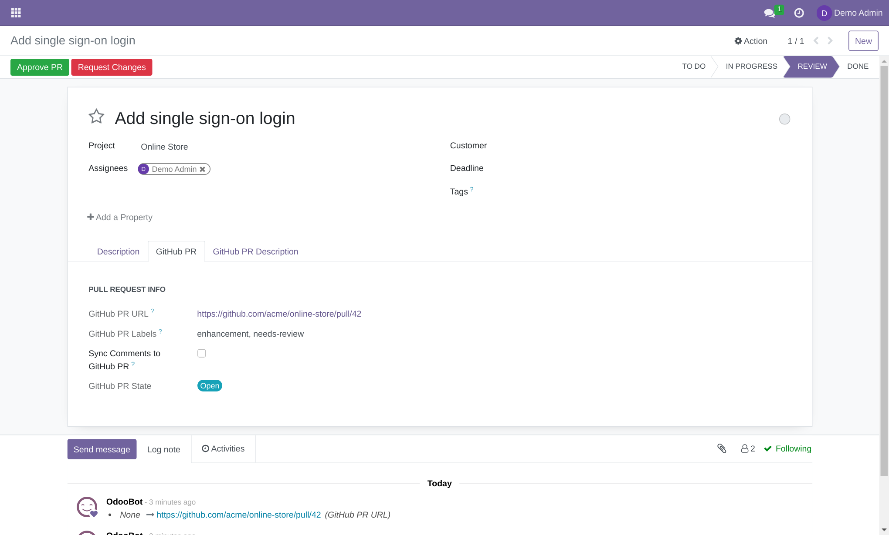
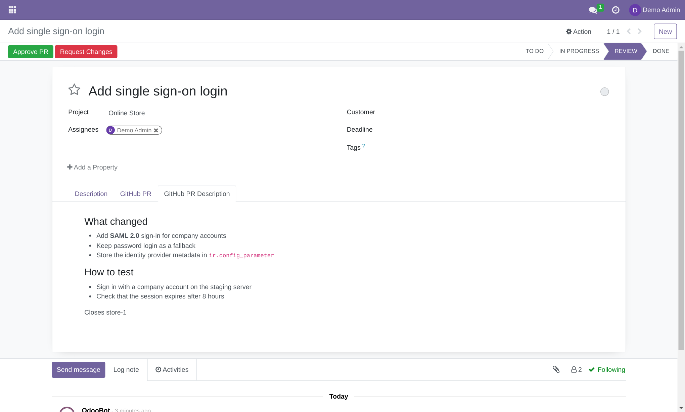
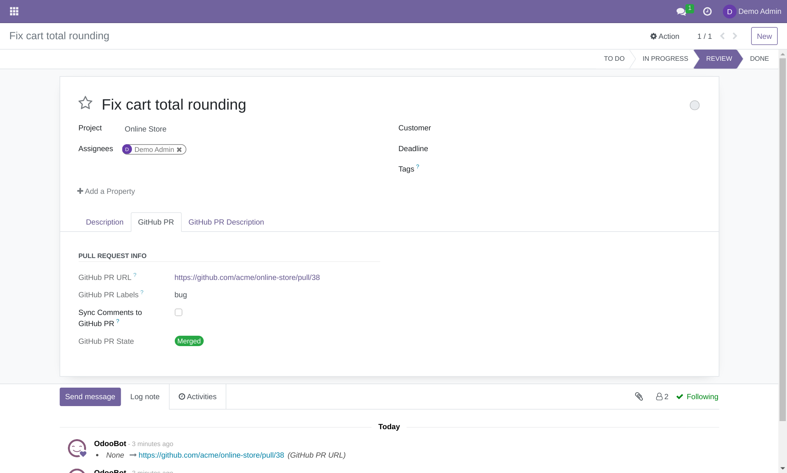
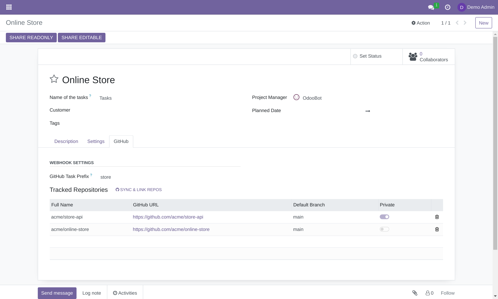
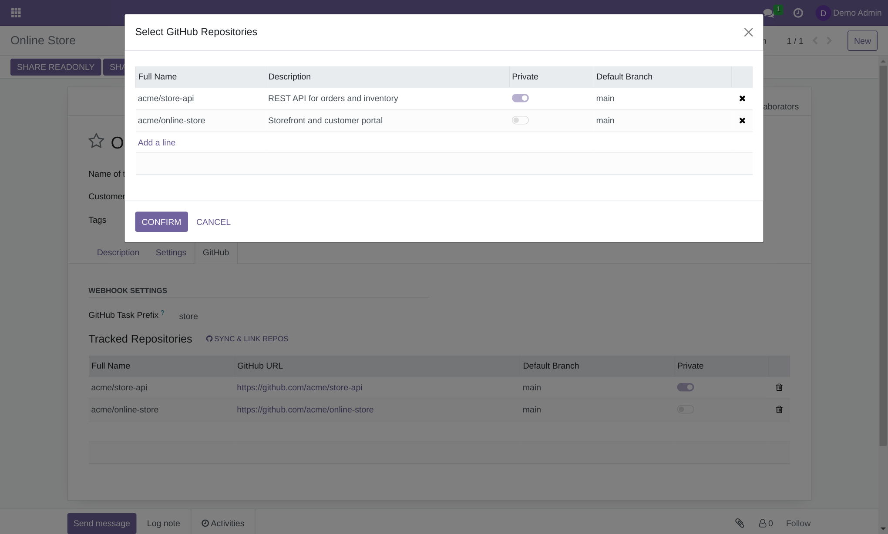
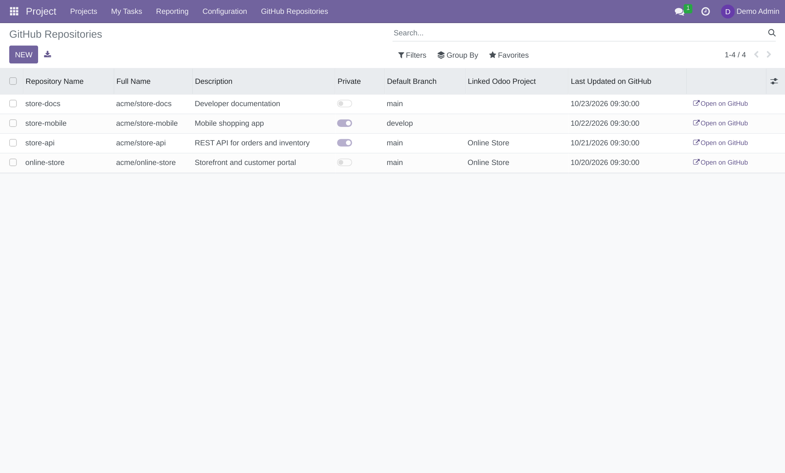
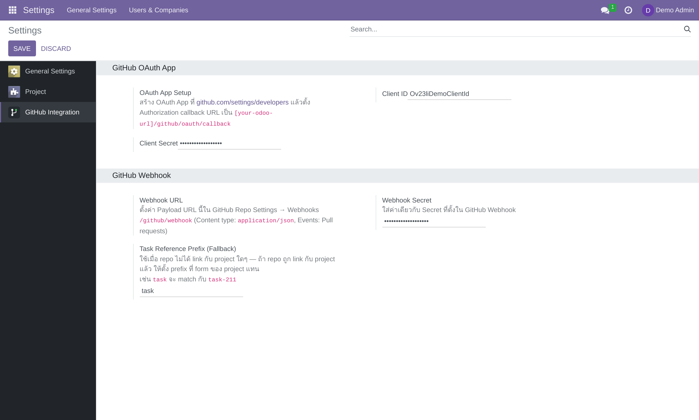
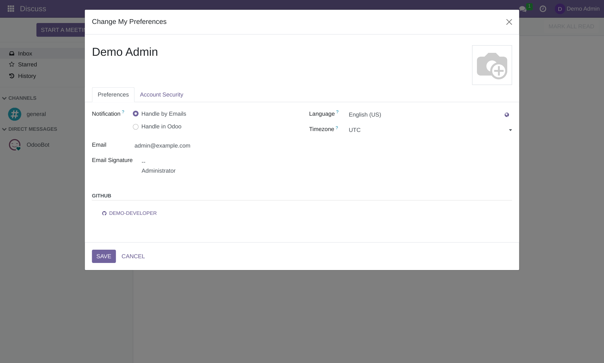
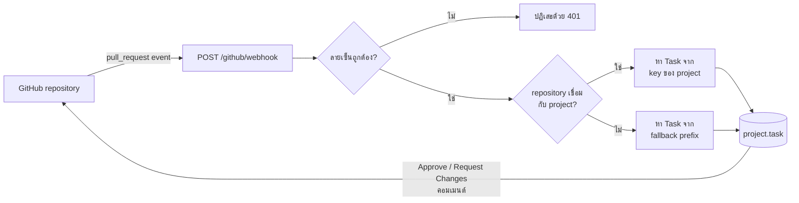

<p align="center">
  
</p>

<p align="center">
  <a href="README.md">English</a> · <b>ภาษาไทย</b>
</p>

<p align="center">
  
  
  
  
</p>

<p align="center">
  เชื่อม GitHub Pull Request กับ Task ใน Odoo Project โดยอัตโนมัติ<br>
  ดูสถานะ PR ได้ใน Task, อนุมัติจาก Odoo ได้ และซิงก์คอมเมนต์ไปยัง PR ได้
</p>

<p align="center">
  
</p>

## สารบัญ

- [ฟีเจอร์](#ฟีเจอร์)
- [ภาพตัวอย่าง](#ภาพตัวอย่าง)
- [ความต้องการของระบบ](#ความต้องการของระบบ)
- [การติดตั้ง](#การติดตั้ง)
- [การตั้งค่า](#การตั้งค่า)
- [วิธีใช้งาน](#วิธีใช้งาน)
- [หลักการทำงาน](#หลักการทำงาน)
- [ความปลอดภัย](#ความปลอดภัย)
- [โครงสร้างโปรเจกต์](#โครงสร้างโปรเจกต์)
- [การรันเทสต์](#การรันเทสต์)
- [การแก้ไขปัญหา](#การแก้ไขปัญหา)

## ฟีเจอร์

| | ฟีเจอร์ | รายละเอียด |
|---|---------|---------|
| 🔗 | **เชื่อมอัตโนมัติ** | ระบุ Task ใน PR description แล้ว webhook จะเชื่อมให้ และ PR เดียวอัปเดตได้หลาย Task |
| 🚦 | **สถานะ PR ล่าสุด** | แสดงป้าย `Open`, `Merged`, `Closed` และ label ของ PR ใน Task |
| 📝 | **แสดง Markdown** | แสดง PR description แบบ Markdown ที่ sanitize แล้ว รองรับ code block และตาราง |
| ✅ | **รีวิวจาก Odoo** | ปุ่ม **Approve PR** และ **Request Changes** จะตั้ง label `ok-to-merge` และ `fix` บน GitHub |
| 💬 | **ซิงก์คอมเมนต์** | เลือกส่งคอมเมนต์จาก chatter ไปยัง PR ได้ |
| 🔐 | **ล็อกอิน GitHub** | ผู้ใช้แต่ละคนเชื่อมบัญชีของตัวเองผ่าน OAuth |
| 📁 | **จัดการ Repository** | ซิงก์ repository, เชื่อมกับ project และแก้ไขคำอธิบายได้ |
| 🛡️ | **ตรวจสอบ Webhook** | ทุกคำขอถูกตรวจลายเซ็นด้วย HMAC-SHA256 |

### วิดีโอสอนใช้งาน

[▶️ ดูบน YouTube](https://youtu.be/Zz5PNZbrCLQ)

## ภาพตัวอย่าง

> ภาพจากฐานข้อมูลทดลองที่ใช้ข้อมูลตัวอย่าง

<table>
  <tr>
    <td width="50%"></td>
    <td width="50%"></td>
  </tr>
  <tr>
    <td align="center"><b>PR description ที่แสดงผลแล้ว</b></td>
    <td align="center"><b>PR ที่ merge แล้ว: ซ่อนปุ่มรีวิว</b></td>
  </tr>
  <tr>
    <td></td>
    <td></td>
  </tr>
  <tr>
    <td align="center"><b>Project: prefix และ repository ที่ติดตาม</b></td>
    <td align="center"><b>เลือก repository ที่จะเชื่อม</b></td>
  </tr>
  <tr>
    <td></td>
    <td></td>
  </tr>
  <tr>
    <td align="center"><b>Project → GitHub Repositories</b></td>
    <td align="center"><b>Settings → GitHub Integration</b></td>
  </tr>
</table>

## ความต้องการของระบบ

| รายการ | เวอร์ชัน / หมายเหตุ |
|------|-----------------|
| Odoo | 16.0 |
| Python | 3.8+ |
| โมดูล Odoo | `project` และ [`project_key`](https://github.com/OCA/project/tree/16.0/project_key) จาก OCA |
| Python library | `markdown` (ไม่บังคับ ถ้าไม่ติดตั้งจะแสดง description เป็นข้อความธรรมดา) |

```bash
pip install markdown
```

## การติดตั้ง

**1. ดาวน์โหลดโค้ด**

```bash
git clone https://github.com/madara1150/project_link_github.git /opt/odoo/custom-addons/project_link_github
```

**2. เพิ่มโฟลเดอร์ของ repository ใน `addons_path`** คือโฟลเดอร์ที่มี `project_github/` อยู่ข้างใน

```ini
[options]
addons_path = /opt/odoo/addons,/opt/odoo/custom-addons/project_link_github
```

**3. Restart Odoo แล้วติดตั้ง** ไปที่ **Apps → Update Apps List** ค้นหา `Project GitHub Integration` แล้วคลิก **Install**

**อัปเกรดจากเวอร์ชันก่อนหน้า?** ให้อัปเดตโมดูลและตั้งค่า webhook secret (ดู[หมายเหตุด้านความปลอดภัย](#ความปลอดภัย))

```bash
odoo-bin -d <database> -u project_github --stop-after-init
```

## การตั้งค่า

### 1. สร้าง GitHub OAuth App

จำเป็นสำหรับการล็อกอิน GitHub, ซิงก์ repository, ปุ่มรีวิว และการซิงก์คอมเมนต์

1. เปิด [github.com/settings/developers](https://github.com/settings/developers) แล้วคลิก **New OAuth App**
2. ตั้ง **Authorization callback URL** เป็น `https://<your-odoo-domain>/github/oauth/callback`
3. คัดลอก **Client ID** และสร้าง **Client Secret**

### 2. ตั้งค่าใน Odoo

ไปที่ **Settings → GitHub Integration**

| ช่อง | คำอธิบาย | ตัวอย่าง |
|------|----------|---------|
| **Client ID** / **Client Secret** | ค่าจาก OAuth App | |
| **Webhook Secret** | จำเป็นต้องตั้ง และต้องตรงกับค่าบน GitHub | ข้อความสุ่มยาว ๆ |
| **Task Reference Prefix (Fallback)** | ใช้กับ repository ที่ไม่ได้เชื่อมกับ project | `task` |

### 3. เพิ่ม Webhook บน GitHub

ใน repository เปิด **Settings → Webhooks → Add webhook**

| ช่อง | ค่า |
|------|-----|
| **Payload URL** | `https://<your-odoo-domain>/github/webhook` |
| **Content type** | `application/json` |
| **Secret** | ค่าเดียวกับใน Odoo |
| **Events** | **Let me select individual events** → **Pull requests** |

### 4. เชื่อมบัญชีของคุณ

เปิดเมนูผู้ใช้ → **Preferences** แล้วคลิก **Connect with GitHub** เมื่อเชื่อมแล้ว ส่วน **GitHub** จะแสดงชื่อผู้ใช้ของคุณ และคลิกที่ชื่อเพื่อยกเลิกการเชื่อมได้

<p align="center">
  
</p>

### 5. เชื่อม Repository กับ Project

ใน project เปิดแท็บ **GitHub** ตั้ง **GitHub Task Prefix** (เช่น `store`) แล้วคลิก **Sync & Link Repos**

## วิธีใช้งาน

### เชื่อม PR กับ Task

ระบุ Task ใน **PR description** โดยไม่สนตัวพิมพ์เล็กใหญ่

```markdown
## สิ่งที่เปลี่ยนแปลง
- เพิ่มการล็อกอินแบบ SSO

Closes store-42, store-43
```

| Repository | รูปแบบการอ้างอิง | สิ่งที่ระบบค้นหา |
|------------|------------------|-------|
| เชื่อมกับ project แล้ว | `{prefix ของ project}-{เลข}` | Task ที่มี key เป็น `{key ของ project}-{เลข}` เช่น `store-42` จะเจอ `STORE-42` |
| ยังไม่เชื่อม | `{fallback prefix}-{id}` | Task ที่มี database ID ตรงกัน เช่น `task-211` จะเจอ Task ID 211 |

### รีวิว PR

เมื่อ PR ยังเปิดอยู่และคุณมีสิทธิ์ push ใน repository นั้น Task จะแสดงปุ่ม 2 ปุ่ม

| ปุ่ม | เพิ่ม label | ลบ label |
|--------|------------|---------------|
| **Approve PR** | `ok-to-merge` | `fix` |
| **Request Changes** | `fix` | `ok-to-merge` |

### ซิงก์คอมเมนต์

ติ๊ก **Sync Comments to GitHub PR** ในแท็บ **GitHub PR** จากนั้นข้อความและ log note ที่เขียนใน Task จะถูกโพสต์ไปที่ PR เป็นข้อความธรรมดาด้วยบัญชี GitHub ของคุณ ดังนั้น **โน้ตภายในจะมองเห็นได้บน GitHub** ส่วนการแจ้งเตือนของระบบจะไม่ถูกส่งไป

### สถานะ PR

| สถานะ | ป้าย | ความหมาย |
|-------|-------|---------|
| `open` | 🔵 | PR ยังเปิดอยู่ |
| `merged` | 🟢 | PR ถูก merge แล้ว |
| `closed` | ⚪ | PR ถูกปิดโดยไม่ merge |

## หลักการทำงาน



## ความปลอดภัย

- **ต้องตั้ง webhook secret** ตั้งแต่เวอร์ชัน `16.0.3.1.0` ทุกคำขอจะได้รับ `401` จนกว่าจะตั้งค่า เพราะ endpoint นี้เป็นสาธารณะ
- **PR description ถูก sanitize** ก่อนแสดงผล
- **Access token** อ่านได้เฉพาะผู้ดูแลระบบ และถูกกันออกจากการอ่านของผู้ใช้ทั่วไป แต่เก็บในฐานข้อมูลแบบไม่เข้ารหัส จึงควรดูแล backup ให้ปลอดภัย
- **Token ใช้ได้เฉพาะเจ้าของ** ผู้ใช้ภายในทุกคนเห็นรายการ repository ได้ แต่มีเพียงเจ้าของรายการเท่านั้นที่ใช้รายการนั้นเรียก GitHub ได้
- **OAuth scope `repo`** เข้าถึง private repository ของผู้ใช้ได้ ผู้ใช้ลบ token ที่เก็บไว้ได้จากปุ่มบัญชีที่เชื่อมอยู่ใน **Preferences**

## โครงสร้างโปรเจกต์

```text
project_link_github/
├── docs/images/                  # รูปใน README
└── project_github/
    ├── controllers/
    │   ├── github_oauth.py       # OAuth login และ API ซิงก์ repository
    │   └── github_webhook.py     # Webhook endpoint และการตรวจลายเซ็น
    ├── models/
    │   ├── github_repository.py  # github.repository
    │   ├── project_project.py    # Prefix และ repository ที่ติดตาม
    │   ├── project_task.py       # ฟิลด์ PR, การจับคู่, label, ซิงก์คอมเมนต์
    │   ├── res_config_settings.py
    │   └── res_users.py          # บัญชี GitHub ของผู้ใช้
    ├── wizard/                   # หน้าต่างเลือก repository
    ├── views/                    # หน้าจอฝั่ง backend
    ├── static/                   # OWL widget, notification service, ไอคอน
    ├── tests/                    # เทสต์อัตโนมัติ
    └── utils.py                  # ตัวช่วยเรียก GitHub API และค่าคงที่
```

## การรันเทสต์

```bash
odoo-bin -d <test_database> -i project_github --test-enable --test-tags=/project_github --stop-after-init
```

## การแก้ไขปัญหา

<details>
<summary><b>GitHub แจ้ง 401 เมื่อส่ง webhook</b></summary>

ตรวจว่าได้ตั้ง **Webhook Secret** ใน Odoo แล้วและตรงกับบน GitHub ทุกตัวอักษร ดูการส่งแต่ละครั้งและคำตอบได้ที่ **Settings → Webhooks → Recent Deliveries** บน GitHub
</details>

<details>
<summary><b>Webhook ได้ 404 หรือไปไม่ถึง Odoo</b></summary>

GitHub ต้องเข้าถึงเซิร์ฟเวอร์ของคุณผ่านอินเทอร์เน็ตได้ และถ้าเซิร์ฟเวอร์มีหลายฐานข้อมูล ต้องตั้ง `dbfilter` ให้ Odoo เลือกฐานข้อมูลได้ เพราะ webhook ไม่มี session มาด้วย
</details>

<details>
<summary><b>Task ไม่ถูกอัปเดต</b></summary>

- ต้องระบุใน **PR description** ไม่ใช่ชื่อ PR หรือ commit
- ตรวจ prefix ใน project หรือ fallback prefix สำหรับ repository ที่ยังไม่เชื่อม
- repository ที่เชื่อมแล้วใช้ key ของ project กับเลข Task ส่วนที่ยังไม่เชื่อมใช้ database ID
</details>

<details>
<summary><b>ไม่เห็นปุ่ม Approve PR และ Request Changes</b></summary>

ปุ่มจะแสดงเมื่อ PR ยังเปิดอยู่ เชื่อมบัญชี GitHub แล้ว และคุณมีสิทธิ์ push ใน repository นั้น
</details>

<details>
<summary><b>PR description แสดงเป็นข้อความธรรมดา</b></summary>

ติดตั้ง `markdown` ใน Python environment ของ Odoo แล้ว restart Odoo
</details>

<details>
<summary><b>ดู log</b></summary>

```bash
tail -f /var/log/odoo/odoo.log | grep -i github
```
</details>

---

<p align="center">
  พัฒนาโดย Aginix Technologies · สัญญาอนุญาต <a href="https://www.gnu.org/licenses/lgpl-3.0.html">LGPL-3</a>
</p>
